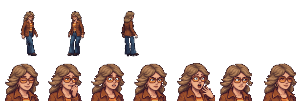

# Diana — visual

Estudante de Direito de uns 20 anos, de 1978. Quem ela é está na ficha [`docs/historia/personagens/diana.docx`](../../../../docs/historia/personagens/diana.docx), que faz parte do Enredo Principal (a lei do projeto).



## Quem ela é, no visual

O visual segue o desenho que a equipe fez dela (`assets/modelagem/personagens/diana_referencia/`: `expressoes.jpg` com os retratos e `andar.jpg` com as poses de caminhada).

- **Cabelo** castanho-claro, volumoso e repicado, no estilo dos anos 70, com as pontas viradas para fora na altura dos ombros.
- **Óculos grandes** de armação laranja, com lentes alaranjadas, e **argolas douradas**.
- **Jaqueta** marrom-caramelo de gola larga, com bolsos no peito e no quadril e os punhos dobrados, aberta sobre uma **camiseta listrada** em amarelo, laranja e creme, com um cinto preto de fivela dourada.
- **Calça jeans boca de sino**, azul, e **botas de plataforma** marrons.
- **Cor de identificação:** a ficha ainda não define uma (a tabela do `resumo.docx` está com "—"). A jaqueta e os óculos puxam para o laranja e o marrom.
- **Postura:** a ficha pede uma estudante sempre em movimento e nervosa. Os ombros ficam um pouco altos, os cotovelos dobrados e o passo é curto e rápido.

A direção de arte da ficha pede uma estudante dos anos 70 com a jaqueta e uma pasta de fichário. O visual desenhado já é de estudante; a pasta ainda não aparece.

## Sprites

Todos em `assets/sprites/personagens/diana/`. Os **sprites do corpo** são gerados por `assets/modelagem/personagens/gerar_diana.py` (Blender, sem abrir a janela), com os mesmos arquivos e tamanhos do Gabriel. Os **retratos** são pixel art feita a partir da folha desenhada, por `assets/modelagem/personagens/pixelar_retratos.py`:

```bash
python assets/modelagem/personagens/pixelar_retratos.py diana
blender -b --factory-startup --python assets/modelagem/personagens/gerar_diana.py
```

| Arquivo | Tamanho | O que é |
|---|---|---|
| `diana_<vista>.png` | 96 × 112 | parada, em cada vista: `lado`, `frente`, `tres_quartos`, `costas`, `tres_quartos_costas` |
| `diana_andar_<vista>.png` | 12 quadros de 96 × 112 | caminhada (dois passos), um arquivo por vista |
| `diana_parado_<vista>.png` | 8 quadros de 96 × 112 | respirando, um arquivo por vista |
| `diana_retrato_<nome>.png` | 80 × 80 | retratos da caixa de diálogo (mostrados em 40 × 40): `normal`, `assustada`, `dramatica` (a mão no rosto, a boca aberta), `ansiosa` (roendo a unha, uma gota de suor), `irritada`, `determinada` e `aliviada` (de olhos fechados, sorrindo) |
| `diana_referencia.png` | — | frente, 3/4, lado e costas, e os retratos do Blender (não os do jogo) |

- **Escala:** a mesma de todos os personagens (1,75 m do Gabriel = 48 px na tela). Ela tem uns 1,65 m de corpo, mais as plataformas e o volume do cabelo.
- **Resolução dobrada:** como o Gabriel, a cena usa `scale = Vector2(0.5, 0.5)` e `offset = Vector2(-46, -108)`. Para a esquerda, o Godot espelha o sprite de lado.
- **Caminhada e respiração:** as do `comum.py`, com o passo curto e rápido e o braço balançando (`PASSO` no script).
- **Paleta:** 48 cores para os sprites e 48 para os retratos.
- **Os retratos do Blender** (`normal`, `assustada` e `irritada`) só entram na folha de referência. O `gerar_diana.py` não grava os `diana_retrato_*.png`, então pode ser rodado sem perder os desenhados.
- **Antes** os sprites do corpo eram pixel art feita direto das poses de caminhada do desenho; foram trocados por estes para ela ficar igual ao resto do elenco.

## No jogo

`cenas/personagens/diana.tscn`: a Diana parada, respirando, com os pés sólidos (o Gabriel não atravessa). O script é o `scripts/personagens/personagem_parado.gd`, que escolhe a vista (`vista`) e se ela olha para a esquerda (`olhando_para_esquerda`). Por enquanto ela só aparece na sala de teste (`cenas/salas/sala_teste.tscn`), onde também entra na troca de personagem (tecla `C`). Na história ela fica na sala 103 do Bloco de salas, com a Clarice; essa cena ainda não a mostra.

## Para mudar

Edite `gerar_diana.py` (cores em `criar_materiais`, peças em `montar` e `cabeca`, expressões do Blender em `expressao`, jeito de andar em `PASSO`) e rode o comando acima. Leva uns 20 minutos e sobrescreve os PNGs dos sprites (menos os retratos) e o `diana.blend`.
