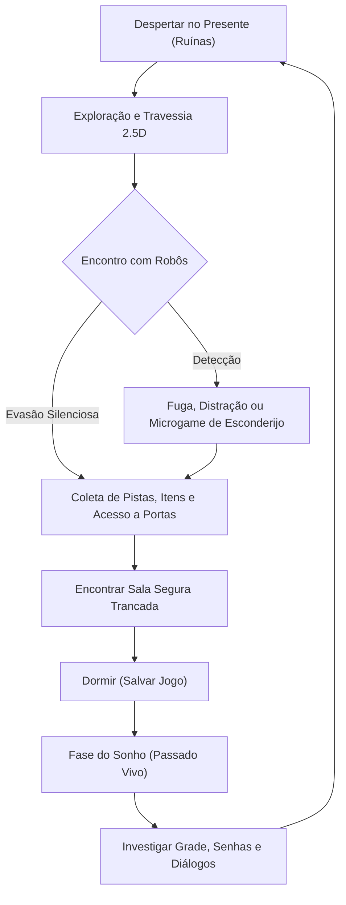

# Mecânicas — Visão Geral e Core Loop

Esta seção detalha todas as regras sistêmicas de jogabilidade de *Ankhor*, cobrindo locomoção, sobrevivência, iluminação, furtividade e a mecânica central do sono/sonhos.

---

## 🔄 O Loop Principal de Gameplay (Core Loop)

1. **Explorar Ruínas no Presente:** Navegar pelo campus desabado, recolhendo pilhas para a lanterna, bilhetes e itens-chave.
2. **Evitar e Sobreviver aos Robôs:** Usar passos lentos, esconderijos com microgames interativos, gestão de luz e arremesso de objetos de distração.
3. **Alcançar Sala Segura:** Localizar áreas estruturalmente intactas com trancas internas.
4. **Dormir para Salvar:** Salvar o progresso e transitar para a dimensão do sonho.
5. **Investigar o Passado:** Conversar com personagens, examinar o passado e encontrar códigos que abrem caminhos no presente.

---

## 📂 Detalhamento dos Módulos

- **[`movimentacao_e_terreno.md`](movimentacao_e_terreno.md):** Controles de locomoção, corrida, gestão de estamina, ruído de passos e navegação vertical/obstáculos.
- **[`furtividade_e_esconderijos.md`](furtividade_e_esconderijos.md):** Tipos de esconderijos (armários, cabines, raízes), microgames de tensão (respiração, imobilidade) e distrações.
- **[`iluminacao_e_lanterna.md`](iluminacao_e_lanterna.md):** A lanterna a pilha, o dilema ver/ser visto, as luzes de emergência e as cápsulas de clarão (previstas).
- **[`vida_e_checkpoint.md`](vida_e_checkpoint.md):** 3 corações, dano dos robôs, tela de morte e checkpoints.
- **[`itens_e_inventario.md`](itens_e_inventario.md):** Pegar, guardar, equipar e usar itens: inventário em grade (matriz), espaços de gadget e a lanterna.
- **[`cofre_e_codigos.md`](cofre_e_codigos.md):** Cofres com código de dígitos, em que o jogador junta as pistas da sala e testa as combinações (o primeiro está no cinema do Centro de Convivência).
- **[`hackeamento.md`](hackeamento.md):** Minigames do notebook para abrir portas trancadas (Sequência e Sincronia), em três dificuldades.
- **[`corredor_do_tempo.md`](corredor_do_tempo.md):** A sala opcional do Labirinto contra o relógio: quatro mecanismos para alinhar no tempo certo, a ansiedade subindo conforme o tempo acaba e game over se ele zera.
- **[`sala_segura.md`](sala_segura.md):** A sala segura de cada fase, onde nenhum robô entra, e os óculos do Zane como máquina de salvar.
- **[`visor_3d.md`](visor_3d.md):** Com os óculos no rosto, o jogo vira 3D em primeira pessoa: o quarto do Gabriel, com as anotações no mural, os documentos na mesa, os números num quadro branco e o save no menu de uma TV.
- **[`colecionaveis.md`](colecionaveis.md):** Uma coleção escondida em cada fase (Biblioteca: três pingentes de farol; Bloco de salas: três disquetes da Clarice; Labirinto: três pingentes do chapéu do Baltazar, um deles só depois do primeiro encontro); ao juntar todas as peças de uma coleção, o quarto do Gabriel ganha uma recompensa (um farol 3D na mesa, uma pilha de disquetes ao lado dele e o tricórnio sobre o notebook, tudo na mesa; Convivência: três botões da jaqueta da Diana, que põem a jaqueta na cama; Bunker: três chips dos óculos do Zane, que põem os óculos no criado-mudo).
- **[`registros_e_caderno.md`](registros_e_caderno.md):** Ler os documentos dos antecessores, as transmissões de rádio (a voz da Clarice) e o Caderno do Gabriel (aba Anotações do inventário, tecla N).
- **[`sono_e_sonhos.md`](sono_e_sonhos.md):** Arquitetura do sistema de save game e jogabilidade investigativa nos sonhos.
